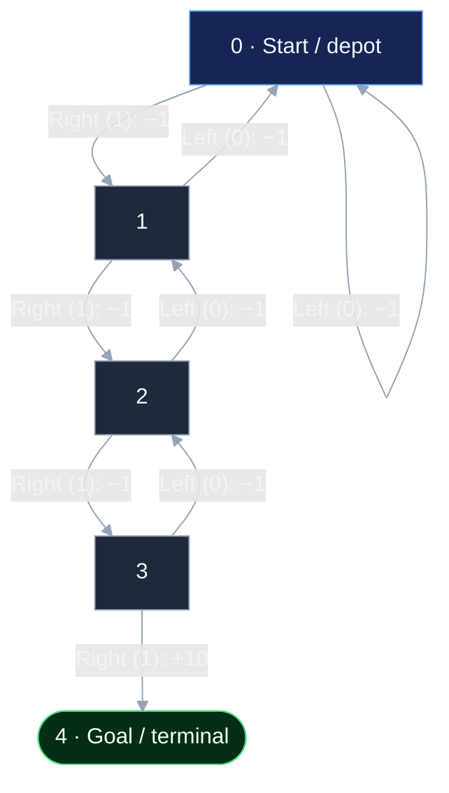
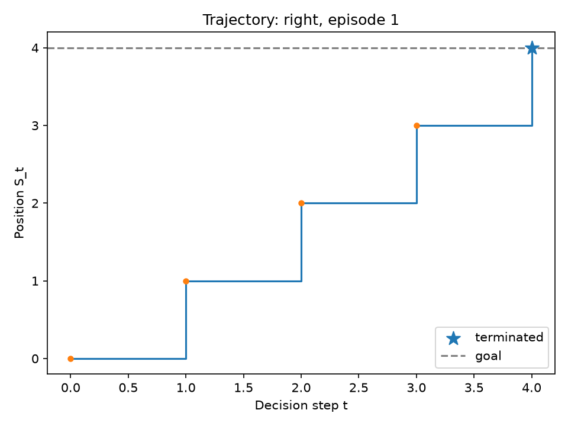
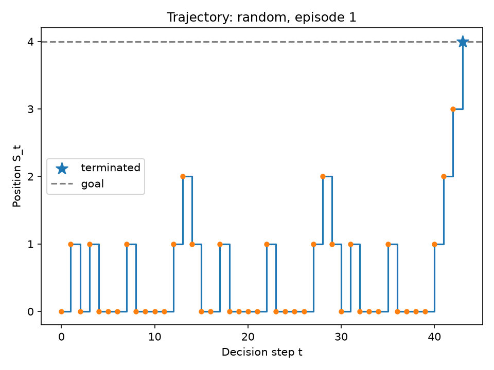
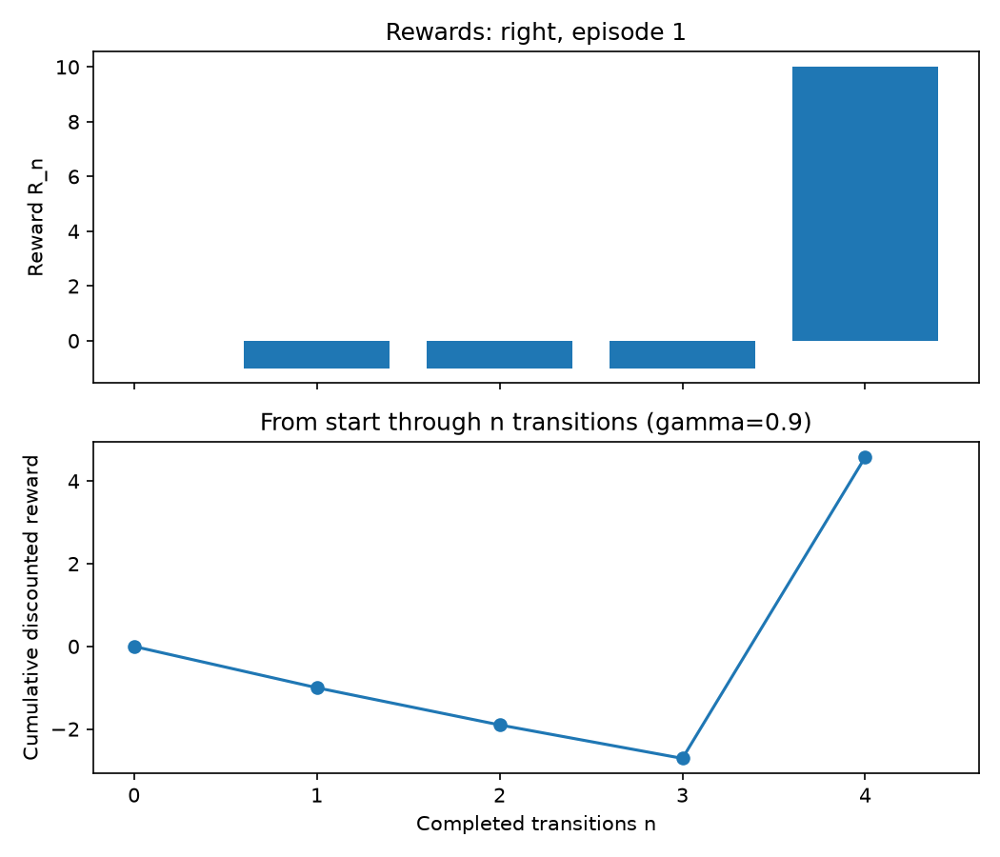
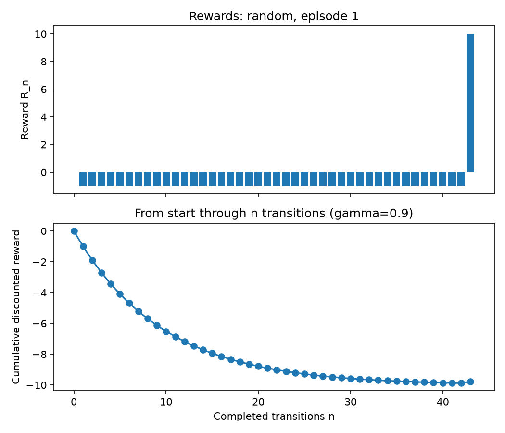
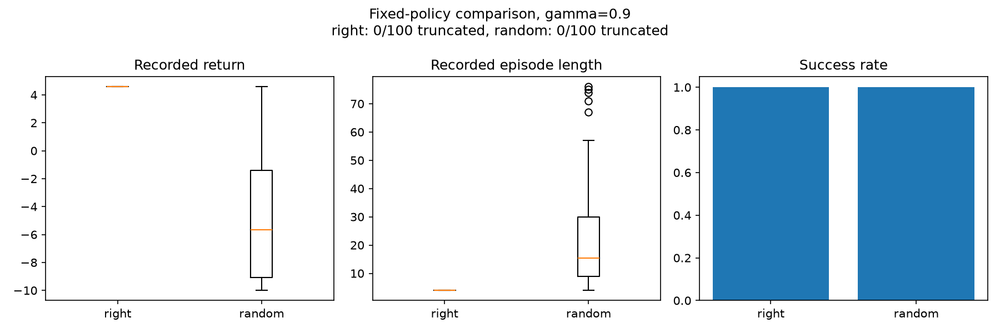
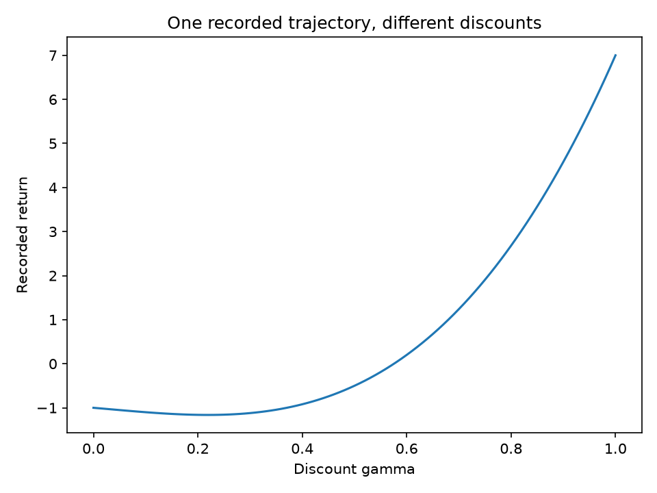
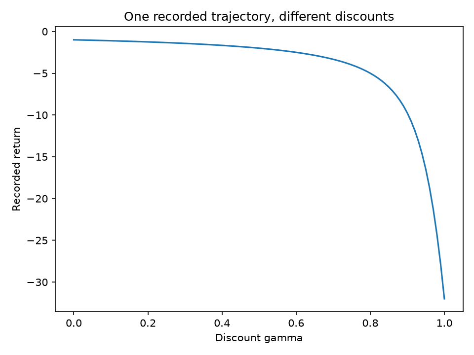
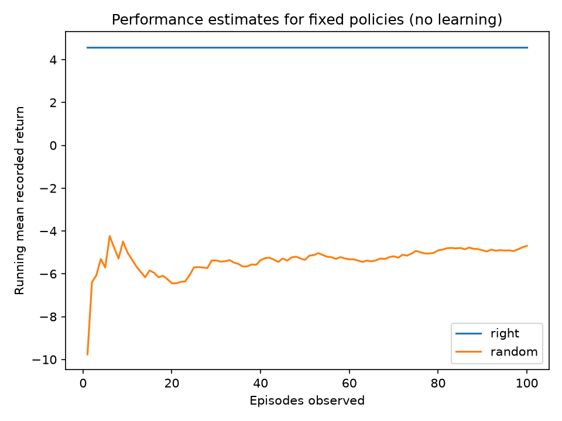

# Lesson 1 — Reinforcement Learning Foundations: Agents, Environments, and MDPs — Version 2 — Hands-on (Python)

> **Vocabulary:** Use the [project glossary](../docs/glossary.md) for the terms and notation shared by all lessons and code.

> **Concepts and theoretical exercises:** [RL-lesson-01-rl-foundations](../lessons/RL-lesson-01-rl-foundations-01.md)\
> **Study pace:** Allow 45–75 minutes for the experiment lab and practical exercises.
>
> **Prerequisites:** Read the companion lesson; Python loops, lists and functions.

> **Code:** Lesson programs are in `src/learning_rl/lessons/lessonNN.py`, where `NN` is the two-digit lesson number (for this lesson, `lesson01.py`).

## Setup and commands

After installation, run lesson commands from any directory with the project virtual environment activated. Relative output paths are resolved from your current directory. Follow the [virtual environment setup](../README.md#create-a-local-virtual-environment) and [package installation instructions](../README.md#install-packages) in the README before starting.

The walkthrough and exercises use the supplied command-line programs. Run experiments with their existing arguments, then report the requested outputs and interpretations. Exercises and solutions follow at the end.

```bash
RL lesson01 --help
```

All options are optional. An option that takes a value requires that value when supplied. Flags take no value.

<a id="command-options"></a>

| Option | Required | Values | Role |
| --- | --- | --- | --- |
| `-h`, `--help` | optional | No value; flag. | Display help and exit. |
| `--policy` | optional | Placeholder: `POLICY`; one [registered policy](#registered-policy-values). Default: `right`. | Select the fixed policy. |
| `--size` | optional | Placeholder: `SIZE`; integer ≥ 2. Default: `5`. | Number of positions, including start and goal. |
| `--episodes` | optional | Placeholder: `EPISODES`; integer ≥ 1. Default: `1`. | Episodes to run per policy. |
| `--max-steps` | optional | Placeholder: `MAX_STEPS`; integer ≥ 1. Default: `100`. | Maximum transitions per episode before truncation. |
| `--gamma` | optional | Placeholder: `GAMMA`; finite real number in [0, 1], dimensionless. Default: `0.9`. | Discount factor used to calculate returns. |
| `--seed` | optional | Placeholder: `SEED`; any integer. Default: `7`. | Seed for reproducible random actions. |
| `--step-reward` | optional | Placeholder: `STEP_REWARD`; finite real number. Default: `-1`. | Reward for transitions that do not enter the goal. |
| `--goal-reward` | optional | Placeholder: `GOAL_REWARD`; finite real number. Default: `10`. | Reward for entering the goal. |
| `--trace` | optional | No value; flag. Default: disabled. | Record every transition in `run.log`; also display it with `--verbose`. |
| `--quiet` | optional | No value; flag. Default: disabled. | Suppress episode summaries; retain the final table and any requested trace. |
| `--compare` | optional | No value; flag. Default: disabled. | Run both registered policies; override `--policy`. |
| `--plots` | optional | Placeholder: `PLOTS_DIRECTORY`; relative or absolute directory path. Default: no plots. | Save PNG plots in this directory, creating it if needed. |
| `--plot-episodes` | optional | Placeholder: `PLOT_EPISODES`; integer ≥ 1. Default: `3`. | Maximum episodes per policy for individual trajectory and reward plots; used with `--plots`. |
| `--verbose` | optional | No value; flag. Default: disabled. | Also display output and summary tables in the terminal. |
| `--output-dir` | optional | Placeholder: `OUTPUT_DIRECTORY`; relative or absolute directory path. Default: `output/lesson01/TIMESTAMP/`. | Save `summary.csv` and `run.log`, creating the directory if needed. Reusing a directory overwrites these files. |

### Registered policy values

| Value of `POLICY` | Role |
| --- | --- |
| `right` | Always move right toward the goal. |
| `random` | Choose left or right with equal probability at each step. |

### Lesson output

Lesson commands automatically save summary tables to `output/lesson01/TIMESTAMP/summary.csv`
and other output to `run.log` in the same directory. Every successful run prints the
saved-file paths. Add `--verbose` to also display results, diagnostics and summary
tables in the terminal.
The log points to the CSV instead of duplicating the tables. Read the saved files for
the outputs discussed below, or use `--verbose` to inspect them on screen.
Each run gets a new directory. Use `--output-dir` to choose a directory; reusing it
overwrites its CSV and log. See [output conventions](../docs/command-outputs.md).

## 1. Guided tutorial — Explore LineWorld

Imagine a courier walking along five numbered stops. Position $0$ is the depot, positions $1,2,3$ are intermediate stops, and position $4$ is the destination.

```text
   Courier starts here
           ↓
       [0] ─── [1] ─── [2] ─── [3] ─── [4]
      Depot    Intermediate stops     Destination
                                        Terminal
```

The environment starts each episode in state $0$. At each decision step, the agent chooses one of two actions: left (coded as $0$) or right (coded as $1$). The next state is the neighboring position in that direction, except that choosing left in state $0$ keeps the agent in state $0$. This still counts as a transition.

Every transition that does not enter state $4$ gives reward $-1$. Entering state $4$ gives reward $+10$ and terminates the episode. State $4$ is therefore the terminal state; no further actions or rewards follow.



Each numbered position is a state. Left at state $0$ leaves the agent there and still earns $-1$. Reaching state $4$ ends the episode; it has no outgoing actions. Arrow labels show the action name, its code, and the reward for that transition.

Going straight right gives rewards $-1,-1,-1,10$. The final move gives $10$ total, rather than $10-1$. This small world lets us inspect every decision without the extra details of a real delivery problem.

Before running the program, predict how many transitions it takes to finish and how a left move changes that number. The program implements specified policies.

### Run from your terminal

See the [command options table](#command-options) for accepted values and defaults. The examples below show the full output with `--verbose`, with summary rows formatted as Markdown tables for readability. In the saved-file paths, `TIMESTAMP` stands for the directory created for that run; path separators depend on your operating system. Seeded random results are reproducible within the same Python environment.

**Inspect one always-right episode.** Follow the courier's decisions from the depot to the goal:

```bash
RL lesson01 --policy right --trace --verbose
```

```text
policy=right episode=1 state=0 action=1 next_state=1 reward=-1
policy=right episode=1 state=1 action=1 next_state=2 reward=-1
policy=right episode=1 state=2 action=1 next_state=3 reward=-1
policy=right episode=1 state=3 action=1 next_state=4 reward=10
policy=right episode=1 steps=4 reward_sum=7.000 return=4.580 terminated=True truncated=False
```

**Summary (gamma=0.9; returns stop at termination or cutoff)**

| policy | episodes | reward_sum | return | steps | success_rate | truncated |
| --- | ---: | ---: | ---: | ---: | ---: | ---: |
| right | 1 | 7.000 | 4.580 | 4.000 | 1.000 | 0 |

`reward_sum`, `return` and `steps` are means over all recorded episodes.

```text
Summary saved to output/lesson01/TIMESTAMP/summary.csv
Output saved to output/lesson01/TIMESTAMP/run.log
```

Each of the first four lines identifies the policy, episode, current state, action, next state, and immediate reward. Read `action=1` as a move right: the states progress from zero to four, and only the last transition earns `10`. The episode summary confirms that reaching the goal terminates the episode after four steps, without truncation.

The final table has one `right` row. Because this run contains only one episode, its mean reward sum, return and step count match the episode summary. The reward sum is $-1-1-1+10=7$; at $\gamma=0.9$, the discounted return is:

$$
G_0=-1-0.9-0.9^2+10(0.9^3)=4.58.
$$

**Compare policies over a batch.** Compare 100 episodes of each fixed policy under the same environment settings:

```bash
RL lesson01 --compare --episodes 100 --seed 7 --quiet --verbose
```

**Summary (gamma=0.9; returns stop at termination or cutoff)**

| policy | episodes | reward_sum | return | steps | success_rate | truncated |
| --- | ---: | ---: | ---: | ---: | ---: | ---: |
| right | 100 | 7.000 | 4.580 | 4.000 | 1.000 | 0 |
| random | 100 | -10.570 | -4.697 | 21.570 | 1.000 | 0 |

`reward_sum`, `return` and `steps` are means over all recorded episodes.

```text
Summary saved to output/lesson01/TIMESTAMP/summary.csv
Output saved to output/lesson01/TIMESTAMP/run.log
```

Read the two rows together. Always-right repeats the four-step route, so its mean results match the single episode above. In this recorded batch, random also reaches the goal in every episode, but takes `21.570` steps on average. The extra movement costs lower its mean reward sum to `-10.570`, while discounting gives a mean return of `-4.697`. Equal success rates therefore do not imply equal performance. Neither policy is learning.

In both tables, `reward_sum`, `return`, and `steps` are means over **all** recorded episodes, including truncated ones. `success_rate` is the fraction reaching the goal; `truncated` is a count. Here both truncation counts are zero; a different seed or step limit can produce truncated random episodes.

The final lines identify the saved files. Summary rows are in `summary.csv`; traces and episode summaries, when requested, are in `run.log`. See [Lesson output](#lesson-output) for their locations and contents. Without `--verbose`, the same files are saved and only their paths are printed to the terminal, including the plot directory when requested.

### Generate plots

Visualize the same 100-episode comparison, using the first episode of each policy for the individual plots:

```bash
RL lesson01 --compare --episodes 100 --seed 7 --quiet --plot-episodes 1 --plots output/lesson01/reference-plots/plots --verbose
```

**Summary (gamma=0.9; returns stop at termination or cutoff)**

| policy | episodes | reward_sum | return | steps | success_rate | truncated |
| --- | ---: | ---: | ---: | ---: | ---: | ---: |
| right | 100 | 7.000 | 4.580 | 4.000 | 1.000 | 0 |
| random | 100 | -10.570 | -4.697 | 21.570 | 1.000 | 0 |

`reward_sum`, `return` and `steps` are means over all recorded episodes.

```text
Summary saved to output/lesson01/TIMESTAMP/summary.csv
Plots saved to WORKING_DIRECTORY/output/lesson01/reference-plots/plots
Output saved to output/lesson01/TIMESTAMP/run.log
```

The summary rows match the batch above: recording and plotting consume no random draws. `WORKING_DIRECTORY` in the plot path stands for the directory from which you ran the command. The command saves the eight PNG files shown below without opening windows. Use distinct plot directories for experiments you want to keep, since later runs reuse these filenames. See the [command options table](#command-options) for other settings.

| Plot | Saved files | What to inspect |
| --- | --- | --- |
| Episode trajectory | `right-1-trajectory.png`, `random-1-trajectory.png` | Positions and ending status of the first episode of each policy. |
| Rewards and cumulative discounted reward | `right-1-rewards.png`, `random-1-rewards.png` | Immediate rewards and the return accumulated from the start. |
| Policy comparison | `comparison.png` | Return and length distributions, success rates, and truncation counts across all 100 episodes per policy. |
| Return by discount factor | `right-1-discount.png`, `random-1-discount.png` | Each first episode scored at discounts from zero to one. |
| Running mean return | `running-mean.png` | Mean recorded return as more episodes of each fixed policy are observed. |

#### Episode trajectories



The always-right trajectory rises by one position at each decision step, matching the four transition lines above. The initial point is $S_0=0$; the star at step four marks termination at the dashed goal line.



The first random episode returns to the depot repeatedly and reaches the goal at step 43. This is one trajectory, whereas `21.570` in the batch table is the mean over 100 trajectories. Both pictured episodes terminate; a truncated episode would end with an X below the goal.

#### Rewards and cumulative discounted reward



In the top panel, the first three rewards are `-1` and the fourth is `10`. In the bottom panel, the cumulative discounted reward falls as movement costs accumulate, then rises to `4.58` when the goal reward arrives. This endpoint matches the always-right return in both summary tables.

The cumulative reward panel shows

$$
C_n=\sum_{t=0}^{n-1}\gamma^t R_{t+1},\qquad C_0=0.
$$

Intermediate points accumulate rewards from the start; they are not future returns $G_t$. The final point equals the episode's recorded return. For a truncated episode, it excludes unobserved future rewards.



The first random episode incurs 42 movement costs before earning `10`. At $\gamma=0.9$, the late goal reward adds only a small amount to the cumulative discounted reward, which ends near `-9.761`. This is the return of that first episode; `-4.697` in the batch table averages the returns of all 100 random episodes.

#### Policy comparison



The always-right boxes collapse to lines because every episode has the same return and length. The random boxes show variation; their orange lines mark medians, while the summary table reports means. Points beyond the length box's whiskers represent unusually long episodes. Both success bars reach one, and the title confirms zero truncations in this batch. Random can therefore be less efficient even when it succeeds every time in the sample.

Compare policies under identical size, reward rule, discount and step limit. If an episode truncates, its recorded length equals the cutoff; the length plot does not estimate how long it would eventually take to finish.

#### Return by discount factor



For the always-right trajectory, discount zero counts only the first reward, giving `-1`; discount one counts every reward equally, giving the reward sum `7`. At discount `0.9`, the curve gives `4.58`, as in the summary table. Changing the discount rescores this recorded trajectory without changing its states or actions.



For the 43-step random trajectory, discount zero again gives `-1`, but discount one gives `-32`: the sum of 42 movement costs and the goal reward. The two curves demonstrate that increasing the discount need not improve a trajectory's return; it changes the weight of delayed costs as well as rewards.

#### Running mean return



The always-right mean stays at `4.58`. The random mean fluctuates as episodes are added, ending near `-4.697` after episode 100, which matches the batch table. This is a performance estimate for a fixed policy, not a learning curve. More observations can stabilize an estimate without improving the policy or guaranteeing a better mean.

### Interpretation

A uniform random walk on this finite line reaches the goal with probability one if allowed to run indefinitely, but it has no fixed upper bound on episode length. A finite safety limit can therefore truncate episodes. A policy that always moves left never reaches the goal.

With sparse rewards and $\gamma=1$, all successful trajectories earn the same return regardless of length. With $\gamma<1$, earlier goal rewards are worth more. Reward design changes the objective as well as the feedback available to learning algorithms.

------------------------------------------------------------------------

## Hands-on convention for this course

Every hands-on lab lives in `lessons-hands-on/` and provides a complete command-line entry point, `--help`, configurable experiment arguments, and example terminal commands. Under "Setup and commands", place the help command before a table of all options with Required, Values, and Role columns. Define placeholders without angle brackets and include accepted values and defaults in Values; place any linked tables of registered values immediately afterward. Exercises ask you to run the supplied code and provide specific outputs and explanations. Plots supplement traces and summary tables; plotting dependencies are installed by default. Future hands-on lessons should follow this convention.

## 2. Practical exercises — Inspect and compare fixed policies

For all exercises, use the supplied program. Include your commands, summary rows and requested plots or traces in your answers. Plots are optional: the summary tables and traces provide a text alternative.

1. **Compare policies and estimate stability.** Run `--compare` with 100 and then 1,000 episodes. Compare mean return, length, success rate and truncation count. Inspect the comparison and running-mean plots if available. Does collecting more episodes train either policy? Explain why a more stable estimate need not be a better score.
2. **Recognize truncation visually.** Run always-right with `--max-steps 2`. Inspect its trajectory and reward plots, or its trace and summary table. Identify the last state and ending status. Is the final cumulative reward the full task return?
3. **Change the discount while preserving a trajectory.** Run always-right with discounts 0, 0.5 and 1. Compare the tables and reward plots; inspect its discount plot. Verify that states and actions do not change. Repeat with a random policy using the same seed and all other settings unchanged.
4. **Compare reward rules.** Compare movement cost / goal reward `(-1, 10)` with sparse rewards `(0, 1)` at $\gamma=1$, using both policies and identical seeds. Use separate plot directories, or compare the tables. Which rule distinguishes fast and slow successful episodes? Then try $\gamma=0.9$ with sparse rewards. Do the fixed policies change their actions?
5. **Compare route lengths.** Run `--compare --episodes 1000 --seed 7 --quiet` for sizes 3, 5 and 8. Provide a table with size, policy, mean return, mean steps, success rate and truncation count. Include a trajectory plot for always-right at each size. Explain why route length changes the return even though neither policy learns.

### Solutions — Exercises 1–5

Try each exercise before reading its solution. Append the indicated `--plots` option to save plots; omit it for text-only runs. Matplotlib is already included in the standard setup.

#### 1. Compare policies and estimate stability

```bash
RL lesson01 --compare --episodes 100 --seed 7 --quiet --plots output/lesson01/100/plots
RL lesson01 --compare --episodes 1000 --seed 7 --quiet --plots output/lesson01/1000/plots
```

Always-right takes four steps, earns total reward `7`, and has return `4.58` at the default discount, with success rate one. Random episodes have variable lengths and returns. More episodes generally give a more stable estimate; they do not train this fixed policy or guarantee a better mean. The running mean can still fluctuate.

Without a cutoff, the expected number of moves from position zero for a uniform random policy is $4(4+1)=20$, and the expected **undiscounted** reward sum is $10-(20-1)=-9$. With the 100-step cutoff, lengths are capped and some runs may fail to finish. These unlimited-run quantities need not equal the reported means; also, discounted return and undiscounted reward sum differ.

#### 2. Recognize truncation

```bash
RL lesson01 --policy right --max-steps 2 --trace --plots output/lesson01/cutoff/plots
```

The trajectory is $0\to1\to2$, with rewards $-1,-1$. Expect `steps=2`, `reward_sum=-2.000`, `return=-1.900`, `terminated=False`, `truncated=True`, and success rate zero. The trajectory ends with an X at position two, below the goal. The final cumulative reward is a partial sum, not an estimate of the unobserved continuation. Reaching position four requires four moves.

#### 3. Change the discount

```bash
RL lesson01 --policy right --gamma 0 --trace --plots output/lesson01/gamma0/plots
RL lesson01 --policy right --gamma 0.5 --trace --plots output/lesson01/gamma05/plots
RL lesson01 --policy right --gamma 1 --trace --plots output/lesson01/gamma1/plots
```

Actions and states remain identical because this policy does not use the discount. For rewards $[-1,-1,-1,10]$, the returns are respectively $-1$, $-0.5$, and $7$. The reward sum remains $7$. The immediate reward panels match, but cumulative discounted reward changes. The discount plot rescales the same recorded rewards without resampling actions. With a random policy, keeping the same seed and all other arguments also preserves trajectories when only the discount changes.

#### 4. Change reward design

```bash
RL lesson01 --compare --episodes 1000 --seed 7 --quiet --gamma 1 --step-reward -1 --goal-reward 10 --plots output/lesson01/cost/plots
RL lesson01 --compare --episodes 1000 --seed 7 --quiet --gamma 1 --step-reward 0 --goal-reward 1 --plots output/lesson01/sparse/plots
RL lesson01 --compare --episodes 1000 --seed 7 --quiet --gamma 0.9 --step-reward 0 --goal-reward 1 --plots output/lesson01/sparse-discounted/plots
```

Always-right earns `7` with movement costs and `1` with sparse rewards at $\gamma=1$. For a successful trajectory of length $T$, the respective undiscounted returns are $11-T$ and $1$. The first rule favors shorter successful paths; the second gives all successes the same return. A truncated sparse-reward run earns zero, so its mean return at $\gamma=1$ equals its success rate. At $0<\gamma<1$, a successful sparse-reward trajectory has return $\gamma^{T-1}$, favoring earlier completion. Changing rewards or discount alone does not change either fixed policy's actions. Compare returns within each reward rule; their scales differ across rules.

#### 5. Compare route lengths

```bash
RL lesson01 --compare --size 3 --episodes 1000 --seed 7 --quiet --plots output/lesson01/size3/plots
RL lesson01 --compare --size 5 --episodes 1000 --seed 7 --quiet --plots output/lesson01/size5/plots
RL lesson01 --compare --size 8 --episodes 1000 --seed 7 --quiet --plots output/lesson01/size8/plots
```

Copy both summary rows for each size into your results table and attach the `right-1-trajectory.png` images. Always-right takes 2, 4 and 7 moves respectively, succeeds every time, and has discounted returns `8`, `4.58` and `0.62882` at the default discount. Its reward sums are `9`, `7` and `4`. Longer routes add movement costs and delay the goal reward. Random runs vary; report the measured means and truncation counts rather than assuming every episode finishes within the default 100-step limit. The policies remain fixed throughout.
